<p align="center">
  
</p>

<p align="center">
  <a href="https://www.anypayx.com"></a>
  <a href="https://www.npmjs.com/package/usdc"></a>
  <a href="https://github.com/anypay/usdc"></a>
</p>

<p align="center">
  <a href="https://www.anypayx.com">Website</a> ·
  <a href="https://www.anypayx.com/docs">Docs</a> ·
  <a href="https://api.anypayx.com/api">API</a> ·
  <a href="https://www.npmjs.com/package/usdc">npm</a> ·
  <a href="https://github.com/anypay">GitHub</a>
</p>

---

## What It Is & Purpose

**Anypay USDC** is a TypeScript SDK that provides a unified interface for USDC (USD Coin) payments across **8+ blockchains**. Instead of learning different chain-specific APIs and wallet libraries, developers can use a single consistent interface to check balances, send payments, and verify transactions across Ethereum, Polygon, Solana, Stellar, Tron, Hedera, Avalanche, and Algorand.

This SDK eliminates the complexity of multi-chain USDC integration by abstracting away the differences between EVM chains (Ethereum, Polygon, Avalanche), account-based chains (Solana, Stellar), and specialized networks (Hedera, Tron, Flow). Each chain adapter handles its own connection management, transaction signing, and status confirmation while exposing three core methods: `getUSDCBalance`, `sendUSDCPayment`, and `checkPaymentStatus`.

Built and maintained by [Anypay](https://www.anypayx.com), this SDK powers multi-chain stablecoin payment acceptance for merchants and developers who need to support USDC across the entire crypto ecosystem without maintaining separate integrations for every chain.

## Why Use It

**Solve multi-chain USDC fragmentation.** USDC exists on 10+ blockchains, each with its own API, wallet format, and transaction model. This SDK gives you one clean interface across all of them.

- **Who it's for:** Payment processors, merchant platforms, exchanges, and dApps that need to accept or send USDC across multiple chains without building 8+ separate integrations.
- **Where it fits:** This SDK sits between your application logic and the blockchain networks. It handles chain-specific wallet management, transaction construction, and status polling so you can focus on your product. Use it standalone in Node.js apps or browsers (via bundlers), or integrate it with the broader [Anypay invoice and payments platform](https://github.com/anypay/anypay).

**Key benefits:**

- **Unified API** — Same three methods (`getUSDCBalance`, `sendUSDCPayment`, `checkPaymentStatus`) work on every supported chain
- **TypeScript Native** — Full type safety, IDE autocomplete, and compile-time checks
- **BIP39 Compatible** — Use standard 12/24-word mnemonics across all chains for easy key management
- **Battle-Tested** — Powers production USDC settlements at Anypay; includes test coverage for all chains
- **Extensible** — Each chain adapter is an isolated module; add new chains or customize existing ones without touching the core

## How It Works

<p align="center">
  
</p>

The SDK abstracts multi-chain USDC payments into a simple four-stage flow:

1. **App Code** — Your application calls the SDK with a chain name and payment parameters (recipient address, amount, mnemonic).

2. **USDC SDK Core** — The SDK routes the request to the appropriate chain adapter and normalizes inputs. All amounts are denominated in USDC (not smallest units), and all addresses are validated before submission.

3. **Chain Adapters** — Each blockchain has a dedicated adapter (`ethereum`, `polygon`, `solana`, `stellar`, etc.) that handles:
   - Loading the USDC token contract address (EVM) or native asset (Stellar/Solana)
   - Deriving wallet keys from BIP39 mnemonics
   - Constructing and signing chain-specific transactions
   - Broadcasting transactions and capturing transaction IDs (txid)

4. **On-Chain Settlement** — The signed transaction is confirmed on the target blockchain. The SDK's `checkPaymentStatus` method polls the chain until confirmation, returning the final state (confirmed, pending, or failed).

**Chain Adapter Strategy:**

- **EVM chains** (Ethereum, Polygon, Avalanche) use `ethers.js` / `web3.js` with the standard ERC-20 ABI to interact with Circle's USDC contracts
- **Solana** uses `@solana/web3.js` and `@solana/spl-token` to transfer USDC as an SPL token
- **Stellar** uses `stellar-sdk` to send USDC as a native Stellar asset
- **Tron** uses `tronweb` to interact with the TRC-20 USDC contract
- **Hedera** uses `@hashgraph/sdk` for HTS token transfers
- **Algorand** uses `algosdk` for ASA-based USDC transfers

All chain implementations are in `src/chains/<chain-name>/index.ts`, making it easy to audit, customize, or extend individual adapters.

## Quickstart / How to Use It

> All commands verified from `package.json` and existing repository code (v0.1.4).

### Installation

Install the SDK from npm:

```bash
npm install --save usdc
```

Or with Yarn:

```bash
yarn add usdc
```

### Basic Usage

Import the chain you want to work with:

```typescript
import { stellar, ethereum, polygon, solana } from 'usdc'
```

**Check a USDC balance** (Stellar example):

```typescript
const balance = await stellar.getUSDCBalance({
  address: 'GDQP2KPQGKIHYJGXNUIYOMHARUARCA7DJT5FO2FFOOKY3B2WSQHG4W37'
})
console.log(balance) // { usdc: '125.50' }
```

**Send a USDC payment** (Ethereum example):

```typescript
const { txid } = await ethereum.sendUSDCPayment({
  mnemonic: process.env.ETHEREUM_USDC_MNEMONIC,
  to: [{
    address: '0x742d35Cc6634C0532925a3b844Bc9e7595f0bEb',
    amount: 10 // 10 USDC
  }]
})
console.log('Transaction ID:', txid)
```

**Check payment status** (Polygon example):

```typescript
const status = await polygon.checkPaymentStatus({
  txid: '0x8f7a2c...'
})
console.log(status) // { confirmed: true, blockHeight: 12345678 }
```

### Supported Chains

| Chain | Import | USDC Contract/Asset |
|-------|--------|---------------------|
| **Ethereum** | `ethereum` | ERC-20 (`0xA0b86991c6218b36c1d19D4a2e9Eb0cE3606eB48`) |
| **Polygon** | `polygon` | ERC-20 on Polygon PoS |
| **Solana** | `solana` | SPL Token |
| **Stellar** | `stellar` | Native Stellar Asset (Circle issuer) |
| **Tron** | `tron` | TRC-20 |
| **Hedera** | `hedera` | HTS Token |
| **Avalanche** | `avalanche` | ERC-20 on Avalanche C-Chain |
| **Algorand** | `algorand` | ASA (Algorand Standard Asset) |

Circle's official USDC contract addresses and asset codes are embedded in each chain adapter. See [Circle's USDC documentation](https://www.circle.com/en/multichain-usdc) for authoritative address references.

### Examples in This Repository

- **MetaMask Demo** — The `metamask-demo/` folder contains a React app demonstrating browser-based USDC payments using MetaMask and the Polygon adapter. Run with `npm start` from that directory.
- **CLI Examples** — `src/bin/cli.ts` provides a command-line interface for testing balance checks and payments across all chains.
- **Test Suite** — `test/*_test.ts` includes working examples for every supported chain (requires environment variables with test mnemonics and addresses).

Run the test suite (requires `.env` with chain-specific test credentials):

```bash
npm test
```

Build the TypeScript SDK:

```bash
npm run build
```

The compiled output will be in `dist/`.

### Environment Variables

For testing or running examples, create a `.env` file with chain-specific mnemonics and addresses:

```bash
# Stellar example
STELLAR_USDC_MNEMONIC="word1 word2 word3 ... word12"
STELLAR_USDC_ADDRESS="GDQP2KPQGK..."

# Ethereum example
ETHEREUM_USDC_MNEMONIC="word1 word2 ... word12"
ETHEREUM_USDC_ADDRESS="0x742d35Cc..."

# Repeat for polygon, solana, tron, hedera, avalanche, algorand
```

## Next Moves for Growth

**High-leverage improvements grounded in the current state of the repository:**

1. **Publish Stale Version to npm** — The repository is at `v0.1.4` in `package.json`, but the latest version on [npm](https://www.npmjs.com/package/usdc) may be outdated. Run `npm version patch && npm publish` to sync the published package with the latest code, ensuring users get recent fixes and features.

2. **Re-enable Flow Chain Adapter** — The Flow chain adapter is commented out in `src/index.ts` (line 3: `//import * as flow from './chains/flow'`). The implementation exists in `src/chains/flow/index.ts`, but it's not exported. Test the Flow adapter against Circle's Flow USDC deployment, then uncomment the import and add Flow to the README's supported chains table.

3. **Add TypeDoc Documentation Site** — `typedoc` is listed in `devDependencies` but there's no generated docs site. Run `npx typedoc --out docs/api src/index.ts` to generate HTML API docs, then publish them to GitHub Pages. This will make the SDK's types and method signatures discoverable without users needing to read source code.

4. **Improve Test Coverage for Error Paths** — The existing test suite (`test/*_test.ts`) primarily tests happy-path flows (balance checks and successful payments). Add tests for common failure scenarios: invalid addresses, insufficient balance, network timeouts, and malformed mnemonics. The `coverage/` folder suggests code coverage is being tracked — aim for 80%+ branch coverage.

5. **Standardize Transaction Receipt Format** — Each chain adapter returns a different transaction receipt structure (EVM chains return full receipts; Stellar returns different fields). Define a shared `PaymentReceipt` interface in `src/protocol.ts` and normalize outputs across all adapters so calling code doesn't need chain-specific handling.

6. **Security: Warn About Mnemonic Handling** — The current examples pass mnemonics directly as strings (`mnemonic: process.env.STELLAR_USDC_MNEMONIC`). Add a prominent security warning in the README about never hardcoding mnemonics or committing them to version control, and document best practices for key management (HSM, secrets managers, ephemeral signing sessions).

## Anypay Ecosystem & License

**Anypay USDC** is part of [Anypay](https://www.anypayx.com) — Bitcoin & Stablecoin payments for business. Merchants and developers use Anypay to accept BTC, ETH, and stablecoins such as USDC, USDT, RLUSD, and NUSD through invoices, APIs, SDKs, webhooks, WooCommerce, and mobile POS.

| Project | Role |
| --- | --- |
| [anypay](https://github.com/anypay/anypay) | Invoice & payments platform / API (`@anypay/server`) |
| [anypay-sdk](https://github.com/anypay/anypay-sdk) | TypeScript SDK for browser & Node.js (`@anypay/client`) |
| [web3-checkout-vite](https://github.com/anypay/web3-checkout-vite) | Current checkout UI (`checkout.anypayx.com`) |
| [walletbot](https://github.com/anypay/walletbot) | Self-custody headless wallet (`@anypay/walletbot`) |
| [anypayx.com](https://github.com/anypay/anypayx.com) | Marketing site, merchant dashboard, and developer docs |

**Related USDC & Payment Infrastructure:**

| Project | Description |
| --- | --- |
| **[anypay/usdc](https://github.com/anypay/usdc)** | ← This repository: multi-chain USDC SDK |
| [anypay/prices](https://github.com/anypay/prices) | Real-time crypto price feeds (REST & WebSocket) |
| [anypay-woocommerce](https://github.com/anypay/anypay-woocommerce) | Official WooCommerce plugin for USDC payments |

### License

This repository declares **ISC** license in `package.json`. However, **no `LICENSE` file exists in the repository root**. 

For clarity, contributors and users should request that a formal `LICENSE` file (ISC or MIT) be added to match the declared intent. Until then, the licensing status is ambiguous.

**Recommended action:** Add a `LICENSE` file to the repository with the full ISC license text, or update `package.json` to reflect the actual license if ISC is not intended.

---

<p align="center">
  <a href="https://www.anypayx.com"></a><br/>
  <sub>Bitcoin & Stablecoin Payments For Business · <a href="https://www.anypayx.com">anypayx.com</a> · <a href="https://x.com/xanypay">@xanypay</a></sub>
</p>
